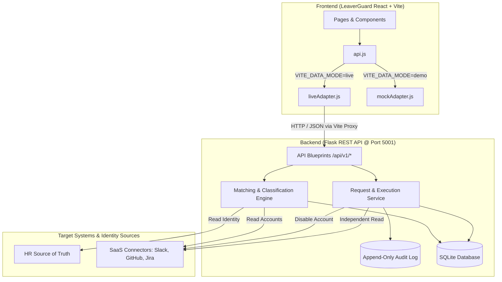
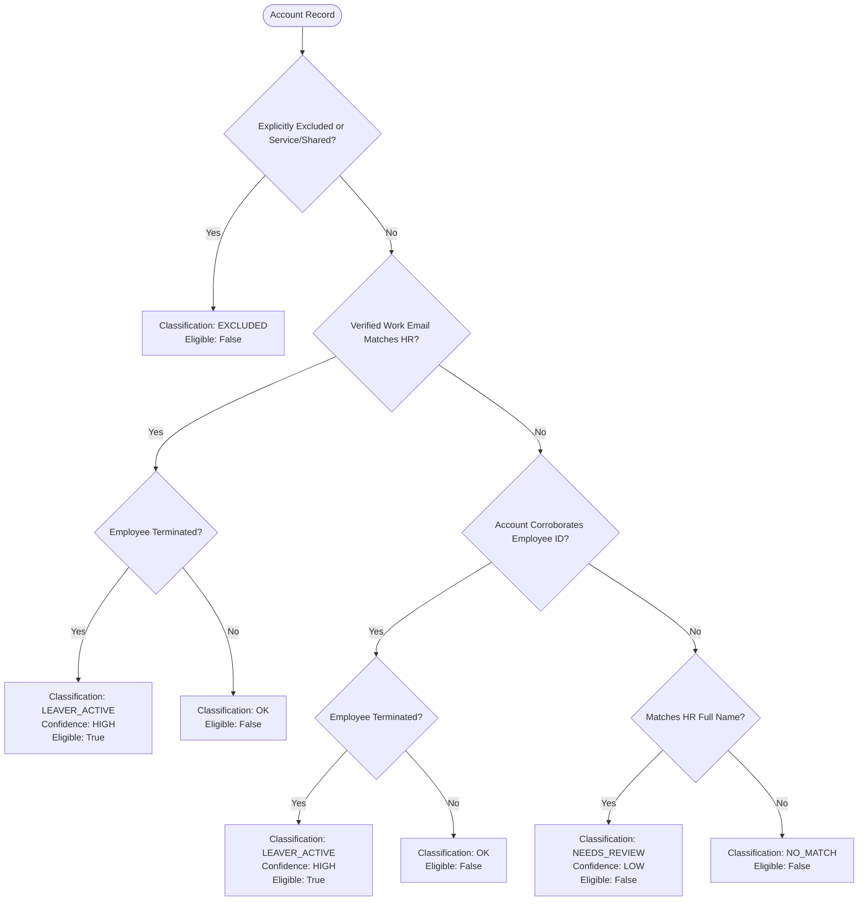
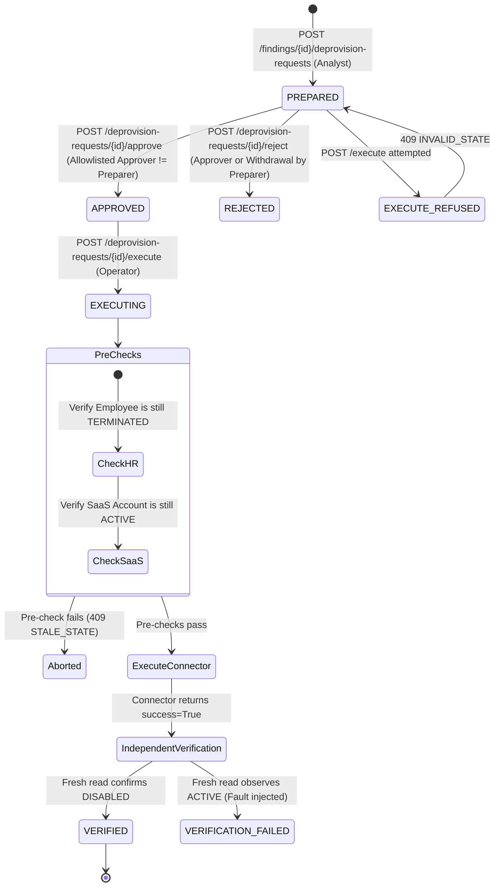

# Leaver Access Review Auditor (LeaverGuard)
## Project Architecture & Integration Documentation

---

### 1. Executive Summary

**Leaver Access Review Auditor** (branded in the UI as **LeaverGuard**) is an enterprise security and compliance platform designed to detect, track, and remediate orphaned SaaS accounts belonging to departed personnel.

#### Core Design & Safety Guarantees
1. **Disable-Only (Zero Deletion)**: There is no delete capability anywhere in the schema, API, connector interface, or frontend. Remediating an account transitions its status strictly to `DISABLED`.
2. **Separation of Duties (Four-Eyes Principle)**: The user who prepares a deprovisioning request is prohibited by server-side invariant checks from approving it.
3. **Independent Verification**: Connector claims of execution success are never trusted blindly. Upon executing a disable action, the auditor performs a distinct, fresh read directly from the target system to confirm that the account state is observed as `DISABLED`.
4. **Immutable Audit Trail**: An append-only log captures every state transition, authorization attempt, refusal, idempotent replay, and verification check.
5. **Dual-Mode Frontend**: The React frontend functions either against live Flask endpoints (`VITE_DATA_MODE=live`) or with self-contained browser-local synthetic state (`VITE_DATA_MODE=demo`).

---

### 2. Architecture & Directory Structure

The project is structured as a clean monorepo separating the Flask backend from the React/Vite web application:

```text
leaver-access-review-auditor/
├── backend/                        # Python / Flask API & SQLite Backend
│   ├── app/
│   │   ├── api/                    # REST Blueprints (scans, findings, requests, audit, dev)
│   │   ├── connectors/             # SaaS connectors (Synthetic connector, Mock admin)
│   │   ├── repositories/           # SQLite data access layer
│   │   ├── services/               # Matching engine, request service, seed & scan service
│   │   ├── config.py               # Environment configuration & validation
│   │   ├── cors.py                 # Strict origin CORS handler
│   │   ├── db.py                   # SQLite connection & schema initialization
│   │   ├── models.py               # Domain dataclasses & enumerations
│   │   └── schema.sql              # Normalized relational database schema
│   ├── data/synthetic/             # Baseline mock accounts, employees, and exclusions
│   ├── docs/                       # API contracts & demo runbooks
│   ├── instance/                   # SQLite database storage (auditor.sqlite3)
│   ├── tests/                      # 212 automated unit and integration tests
│   ├── pytest.ini                  # Pytest configuration
│   ├── requirements.txt            # Python dependencies (Flask, etc.)
│   └── run.py                      # Development server runner
│
├── frontend/                       # React 18 + Vite Web Application
│   ├── src/
│   │   ├── components/             # Reusable UI pieces (Cards, Drawers, Badges, Tables)
│   │   ├── context/                # DemoRole context (Analyst vs Approver)
│   │   ├── data/                   # Synthetic mock data definitions
│   │   ├── hooks/                  # Custom async hooks (useAsync)
│   │   ├── layouts/                # App shell, navigation sidebar, and top bar
│   │   ├── pages/                  # Overview, Findings, Requests, Execution, Audit Trail, Status
│   │   ├── services/
│   │   │   ├── api.js              # Mode switcher (Mock vs Live)
│   │   │   ├── config.js           # Configuration loader (.env.local)
│   │   │   ├── executionStore.js   # Local execution store (demo mode)
│   │   │   ├── liveAdapter.js      # Live Flask API client adapter
│   │   │   ├── mockAdapter.js      # Standalone synthetic adapter
│   │   │   └── requestStore.js     # Local request store (demo mode)
│   │   ├── styles/global.css       # Design tokens, typography, and component styling
│   │   └── utils/                  # Audit events, classifications, and query utils
│   ├── .env.example                # Environment variable template
│   ├── .env.local                  # Active local config (VITE_DATA_MODE=live)
│   ├── index.html                  # HTML entry point
│   ├── package.json                # Dependencies (Lucide React, React Router, Vite)
│   └── vite.config.js              # Vite config with dev proxy (/api -> 5001)
│
├── .gitignore
├── PROJECT_DOCUMENTATION.md        # Complete architecture & operations documentation
└── README.md                       # Root startup instructions
```

---

### 3. System Data Flow & Architecture



---

### 4. Identity Matching & Classification Engine

The matching engine reconciles external accounts against HR employee records using a deterministic confidence ladder:



#### Classification Definitions
| Classification | Meaning | Eligible for Deprovisioning? |
|---|---|---|
| `LEAVER_ACTIVE` | HIGH-confidence match to a terminated employee, and account is `ACTIVE`. | **Yes** (`deprovision_eligible: true`) |
| `NEEDS_REVIEW` | Ambiguous or name-only match. Identity unconfirmed. | **No** (requires human analyst review) |
| `EXCLUDED` | Shared mailbox or service bot account explicitly exempted by policy. | **No** |
| `NO_MATCH` | No HR record corresponds to this account identity. | **No** |
| `OK` | Employee is active, or former employee's account is already `DISABLED`. | **No** |

---

### 5. Deprovisioning Request Lifecycle

Every deprovisioning action follows an audited state machine enforced on the server:



---

### 6. Official Test Cases Demonstrated (TC1 – TC4)

All four official demonstration test cases were validated across backend unit tests and live execution:

| Test Case | Scenario Description | Tested Entity | Input Action | Expected & Actual Result | Evidence Recorded |
|---|---|---|---|---|---|
| **TC1** | Leaver still active in a tool | Rahul Verma (`E101`), terminated 2026-09-15 | `GET /findings/1` | Flagged as `LEAVER_ACTIVE`; last login shown (`2026-09-14T17:42:00Z`). Null for tools without login timestamps. | `ACCOUNT_RECORD`, `HR_RECORD`, `LAST_LOGIN`, `MATCH_RATIONALE` |
| **TC2** | Employee changed surname | Priya Sharma (`S-1002`) vs Priya Nair (`E102`) | `GET /findings/2` | Matched on verified work email `priya.sharma@acme.example` with `HIGH` confidence. | `MATCH_RATIONALE` with `name_differs: true` and explanation note |
| **TC3** | Shared service account | IT Alerts Bot (`S-1005`), Slack service bot | `GET /findings/5` | Flagged as `EXCLUDED`; `deprovision_eligible: false`. `employee: null`. | `EXCLUSION_RULE` (`ACCOUNT_TYPE: SERVICE`), `ACCOUNT_RECORD` |
| **TC4** | Deprovision request lifecycle | Rahul Verma & Priya Nair remediation | Lifecycle sequence (Prepare → Approve → Execute) | Request cannot execute while `PREPARED` (409 error); requires allowlisted approver; executed only when `APPROVED`; verified via fresh read. | `DEPROVISION_PREPARED`, `DEPROVISION_APPROVED`, `DEPROVISION_EXECUTED`, `DEPROVISION_VERIFIED` |

---

### 7. Running the Integrated Project

#### Prerequisites
- Python 3.10+
- Node.js 18+ & npm

#### Running the Backend
From the repository root:
```bash
cd backend
python -m venv .venv

# On Windows PowerShell:
.venv\Scripts\Activate.ps1
$env:DEMO_MODE="1"
$env:FRONTEND_ORIGIN="http://localhost:5173"
$env:APPROVER_ACTORS="demo-approver,approver@acme.example,approver2@acme.example"
python run.py
```
*Backend runs on `http://127.0.0.1:5001/api/v1`.*

#### Running the Frontend
In a separate terminal window:
```bash
cd frontend
npm install
npm run dev
```
*Frontend runs on `http://localhost:5173/`.*

#### Switching Modes
Edit `frontend/.env.local`:
- **Live Mode (Connected to Flask API)**:
  ```env
  VITE_DATA_MODE=live
  VITE_API_BASE_URL=http://127.0.0.1:5001/api/v1
  ```
- **Demo Mode (Self-contained in browser)**:
  ```env
  VITE_DATA_MODE=demo
  ```

#### Running Automated Tests
- **Backend Tests (212 tests)**:
  ```bash
  cd backend
  python -m unittest discover -s tests -t . -v
  ```
- **Frontend Production Build**:
  ```bash
  cd frontend
  npm run build
  ```
